  <picture>
    <source media="(prefers-color-scheme: dark)" srcset="./assets/card-dark.svg">
    <source media="(prefers-color-scheme: light)" srcset="./assets/card-light.svg">
    
  </picture>

  
  

---

### ✦ Featured work

<table>
<tr>
<td width="50%" valign="top">

#### [Argus](https://github.com/NLBoa/Argus)
Always-on course hub that runs on a Raspberry Pi 4B. It pulls deadlines, announcements and course materials from Canvas, Gradescope, Piazza and umd.io, estimates the effort, ranks the work into a queue for my work windows, and reminds me by text. Deadline alerts are **deterministic and never depend on AI**. A **read-only MCP server** lets Claude read the collected deadlines to plan my week, and the dashboard is reachable from anywhere over Tailscale.

`Python` `SQLite` `Raspberry Pi` `MCP` `Tailscale`

</td>
<td width="50%" valign="top">

#### [Smart Display](https://github.com/Sheel2007/OMEGA-WB)
Touchscreen home board for our apartment, running full screen on a Raspberry Pi and built with two roommates. I built the **Zigbee lighting** (pairing, schedules, motion-sensor control, low-battery alerts; setup in [zigbee_ceiling](https://github.com/NLBoa/zigbee_ceiling)), the Spotify widget, the Sports page with live scores, line-ups and a game-day countdown, the barcode-scan grocery list, and the layout that lets you move and resize widgets. A standard-library Python server and plain HTML/CSS/JS, with no build step.

`Python` `JavaScript` `Raspberry Pi` `Zigbee/MQTT` `Spotify API`

</td>
</tr>
<tr>
<td width="50%" valign="top">

#### [Jupiterp](https://github.com/atcupps/Jupiterp/pull/975)
Open-source course scheduler for University of Maryland students, live at [jupiterp.com](https://jupiterp.com). My merged contribution **syncs the Course Planner into the Schedule Generator**: the courses a student has planned fill in the generator automatically and stay in step as the plan changes, so nobody re-enters them. Shipped with 200+ lines of new tests.

`Svelte` `TypeScript` `Open source`

</td>
<td width="50%" valign="top">

#### [Aegis Orbit](https://github.com/KingXaney/Aegis-Orbit-)
Hackathon team project: a satellite collision-avoidance simulator. An XGBoost ranker scans an **18,598-object orbital catalog**, physics screening confirms the threats, and an agent plans and explains avoidance burns on a 3D CesiumJS globe. I built the catalog-explorer home page (live globe, search and filters, loading states), the sandbox flight-deck HUD, and the "ghost" replays that show the collision a burn avoided. ([live demo](https://aegis-orbit-liart.vercel.app))

`React` `TypeScript` `CesiumJS` `FastAPI` `XGBoost`

</td>
</tr>
</table>

### ✦ Toolbox

| | |
|---|---|
| **Languages** |       |
| **Web & Backend** |     |
| **Cloud & Tools** |         |
| **Libraries** |     |
| **Hardware** |    |

### ✦ More projects

| | |
|---|---|
| **[Java Shell](https://github.com/NLBoa/Java-Shell)** | POSIX-style shell written from scratch in Java: bash-style quoting, pipelines, output redirection and background jobs |
| **[Scheduling engine](https://github.com/NLBoa/GulfCoastEstatesSchedulingDemo)** | Demo of the C# scheduling engine from my Gulf Coast Estate Care internship: per-employee capacity across 3 license tiers, with recurring contracts booked all-or-nothing |
| **SKIBUS** | Check-in and boarding system in C#, Razor Pages and SQL that cut student check-in time roughly 10x across 180+ person-trips; led a 5-person student team over 4 seasons |
| **[UMD event feed](https://github.com/NLBoa/BitcampCloudforceProj)** | Bitcamp hackathon team project: scrapers for the UMD calendar, TerpLink and Reddit feeding a FastAPI events API with filtering and tagging |
| **[LED matrix grad cap](https://github.com/NLBoa/RGBMATRIXIMAGE)** | Graduation cap with an RGB LED matrix driven by a Raspberry Pi |

<!--
How this page is made
  profile.toml          the text on the right half of the card
  tools/ascii_face.py   turns a head-turn video into the ASCII frames
  tools/build_card.py   builds assets/card-dark.svg and assets/card-light.svg
-->
